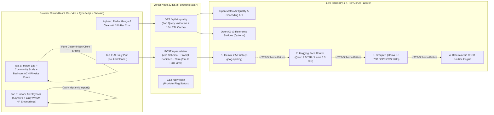

# VayuShield AI

**Urban Air Quality Telemetry, Deterministic Indoor Physics & 4-Tier Resilient Planning**

[](https://vayushield-ai-rose.vercel.app/)
[](tsconfig.json)
[](src/test/App.a11y.test.tsx)
[](package.json)
[](src/test/App.a11y.test.tsx)
[](.github/workflows/ci.yml)

**Live Demo:** [https://vayushield-ai-rose.vercel.app/](https://vayushield-ai-rose.vercel.app/) · **Architecture Reference:** [docs/ARCHITECTURE.md](docs/ARCHITECTURE.md)

VayuShield AI converts live urban air pollution telemetry into verifiable, household-level decisions. Rather than letting a language model guess AQI bands or fabricate health metrics, every pollutant sub-index, 24-hour clean-air window, indoor particulate decay curve, commute CO₂ delta, and community multiplier is computed deterministically in strict TypeScript—and the GenAI layer only synthesizes daily schedules grounded in those verified numbers.

---

## Why VayuShield AI

| Capability                      | Generic AQI Apps & LLM Chatbots                                                                       | VayuShield AI                                                                                                                                                                                                                                                                                                       |
| :------------------------------ | :---------------------------------------------------------------------------------------------------- | :------------------------------------------------------------------------------------------------------------------------------------------------------------------------------------------------------------------------------------------------------------------------------------------------------------------ |
| **AQI Calculation**             | Often relies on generic US-EPA estimates or ungrounded LLM approximations susceptible to unit errors. | **Deterministic India CPCB NAQI Engine** ([`cpcbAqi.ts`](src/engine/cpcbAqi.ts)) across all 6 pollutants (`PM2.5`, `PM10`, `NO₂`, `SO₂`, `O₃`, `CO`) with contiguous breakpoints clamped to `[0, 500]`.                                                                                                             |
| **Daily Timing Guidance**       | Static advice ("go out early morning") that misses thermal inversions or stale past forecast hours.   | **24h Clean-Air Window Finder** ([`openMeteoForecast.ts`](src/engine/openMeteoForecast.ts), [`cleanAirWindow.ts`](src/engine/cleanAirWindow.ts)) slicing strictly upcoming hours in the city's local timezone and ranking 2-hour windows by NAQI.                                                                   |
| **Indoor Air Physics**          | Vague tips such as "run an air purifier."                                                             | **Bedroom Time-to-Clean ACH Simulator** ([`roomCleanPhysics.ts`](src/engine/roomCleanPhysics.ts), [`RoomCleanCurve.tsx`](src/components/RoomCleanCurve.tsx)) solving exponential decay $C(t) = C_{eq} + (C_0 - C_{eq})e^{-\text{ACH} \cdot t/60}$ across room volumes & CADR setups to exact minutes-to-`30 µg/m³`. |
| **Household & Community Scale** | Qualitative slogans with no measurable tradeoff comparison.                                           | **Choice-Impact & Community Scale Engine** ([`impactCalculator.ts`](src/engine/impactCalculator.ts)) computing daily `µg/m³` exposure drops (capped at 92%), annual CO₂ savings, tree equivalents, `1–200` household scaling, and 1-click Family Alerts ([`communityAlert.ts`](src/engine/communityAlert.ts)).      |
| **Resilience & Privacy**        | Single-provider lock-in or browser-exposed `VITE_*` API keys.                                         | **Zero-Key-Leak 4-Tier Server Failover** ([`providers.ts`](api/_lib/providers.ts)): `Gemini 2.5 Flash` → `Hugging Face Router` → `Groq` → `Deterministic Fallback`, plus opt-in lazy **Browser WASM Semantic Search** (`@huggingface/transformers`).                                                                |

---

## Chosen Vertical

**Urban Air Quality & Climate-Tech — Personal & Household Environmental Health Assistant.** Designed for urban families, commuters, and sensitive groups (children, seniors, and residents with respiratory sensitivities) navigating severe particulate episodes under India's CPCB NAQI framework.

---

## Approach

1. **Separate deterministic math from generative language**: All health bands, pollutant sub-indices, hourly window rankings, exposure reductions, carbon savings, and exponential indoor PM2.5 decay curves are computed purely in strict TypeScript under [`src/engine/`](src/engine/). LLMs only format grounded schedules from verified numbers and never compute AQI scores.
2. **Design for graceful offline and free-tier failover**: The serverless assistant chains `Gemini 2.5 Flash` → `Hugging Face Router` → `Groq` → `Deterministic Fallback`, while the client falls back cleanly to direct Open-Meteo telemetry and built-in deterministic planning during pure static or offline execution.
3. **Keep architecture modular, bounded, and accessible by default**: Every runtime module stays focused (`< 250` lines), external payloads are validated at trust boundaries with Zod or strict runtime guards, in-memory caches use bounded TTL/LRU eviction, and WCAG 2.1 AA semantics (`ErrorBoundary` recovery alerts, `aria-expanded`/`aria-controls` disclosures, SVG `<title>`/`<desc>`, and keyboard navigation) are verified automatically on every build.

---

## Assumptions

- **Single-zone indoor mixing**: The Bedroom Time-to-Clean Simulator models a well-mixed single room (`C(t) = C_eq + (C₀ − C_eq)·e^(−ACH·t/60)`) with a 9 ft ceiling, `0.4 h⁻¹` background infiltration, and initial indoor PM2.5 estimated at `78%` of outdoor ambient PM2.5.
- **Urban commute benchmarks & workdays**: Commute CO₂ calculations assume `240` round-trip commute days per year using standard urban per-passenger emission factors (`0.192 kg CO₂/km` solo car down to `0` for cycling/walking/WFH) and `21 kg CO₂/year` per mature tree.
- **Forecast availability & units**: Open-Meteo supplies hourly pollutant series in `µg/m³` (with CO converted from `µg/m³` to `mg/m³` for CPCB NAQI interpolation). Optional OpenAQ v3 `/v3/locations` lookups supply nearest ground-station provenance metadata rather than direct sensor concentration overrides.
- **Stateless serverless instances**: Per-endpoint rate limiting (`20` req / `5 min` on `/api/assistant`, `60` req / `5 min` on `/api/air-quality` per IP) and telemetry caching (`15` minutes or next forecast hour) are bounded in-memory per serverless instance (`500`-entry TTL/LRU cap) alongside CDN edge `Cache-Control` headers.
- **Non-medical guidance**: Outputs provide educational and household planning estimates and are not clinical or medical advice.

---

## How it Works

1. **Location & Live Telemetry (`GET /api/air-quality`)**: Selecting a preset, searching via Open-Meteo Geocoding, or using browser geolocation fetches current and 48-hour forecast pollutant series (`PM2.5`, `PM10`, `NO₂`, `SO₂`, `O₃`, `CO`) validated with Zod and cached up to 15 minutes (or until the next forecast hour).
2. **CPCB NAQI & 24h Clean-Air Window Engine**: `readOpenMeteoForecast` converts `CO` (`µg/m³ → mg/m³`), interpolates continuous CPCB sub-indices (`0–500`), slices strictly upcoming 24 hours in the city's local timezone, and `analyzeCleanAirWindows` ranks consecutive 2-hour pairs by overall NAQI first (breaking ties by `PM2.5`).
3. **Choice-Impact, Community Scale & ACH Room Physics**: Toggling daily habits, swapping commutes, scaling `1–200` households, or switching bedroom size & CADR presets recalculates personal exposure drops (capped at `92%`), annual CO₂ savings, and exact minutes to reach India CPCB Good (`30 µg/m³`) synchronously in the browser.
4. **Grounded Routine Planner (`POST /api/assistant`)**: Validates request payload size (`<= 16 KB`) and schema, enforces per-IP rate limits using trusted platform headers, sanitizes prompt text, and dispatches through the 4-tier LLM failover chain with Zod schema output normalization.
5. **Opt-In Local Semantic Playbook**: Keyword search runs instantaneously offline; clicking **Local HF Semantic Match (WASM)** lazily loads `@huggingface/transformers` (`Xenova/all-MiniLM-L6-v2`) inside the browser CSP without external LLM calls.

---

## System Architecture



---

## Key Engineering Safeguards

Each scientific boundary, serverless boundary, and SVG rendering edge case is guarded by deterministic unit and integration checks:

1. **CO `µg/m³ → mg/m³` Unit Normalization ([`src/engine/cpcbAqi.ts`](src/engine/cpcbAqi.ts))**
   - Open-Meteo reports `carbon_monoxide` in `µg/m³` (`300–2500 µg/m³`), whereas India CPCB NAQI breakpoints expect `mg/m³` (`0–1.0`, `1.0–2.0`, …). `calculateCpcbAqi` explicitly accepts `coUgM3` and divides by `1000` before interpolation, preventing a 1000× score inflation and verified in [`src/test/cpcbAqi.test.ts`](src/test/cpcbAqi.test.ts).
2. **Contiguous CPCB Breakpoint Intervals ([`src/engine/cpcbAqi.ts`](src/engine/cpcbAqi.ts))**
   - Official summary tables list discrete integer intervals (`0–30`, `31–60`) that leave fractional gaps (`30.4 µg/m³`). VayuShield AI models upper bounds contiguously (`0–30`, `30–60`, `60–90`, `90–120`, `120–250`, `250–500`) and clamps sub-indices to `[0, 500]`.
3. **Strict Future 24-Hour Window Slicing ([`src/engine/openMeteoForecast.ts`](src/engine/openMeteoForecast.ts))**
   - Open-Meteo `hourly` arrays start at local midnight (`00:00`), so slicing `0..23` in the evening would surface stale past hours. `readOpenMeteoForecast` requests `forecast_days=2&timezone=auto&timeformat=unixtime`, locates the first entry strictly after `now`, slices the next 24 upcoming hours, and formats labels in the city's timezone (verified in [`src/test/cleanAirWindow.test.ts`](src/test/cleanAirWindow.test.ts)).
4. **NAQI-First Window Ranking on Ozone-Dominated Days ([`src/engine/cleanAirWindow.ts`](src/engine/cleanAirWindow.ts))**
   - When ground-level ozone (`O₃`) drives overall NAQI above `PM2.5`, ranking slots by `PM2.5` alone misidentifies high-ozone hours as clean. `analyzeCleanAirWindows` ranks consecutive 2-hour windows by average overall NAQI first (breaking ties by `avgPm25`) and clamps `exposureSavingsPct` to `0` when the cleanest NAQI slot has equal or higher `PM2.5`.
5. **Serverless ESM Isolation & Opt-In Lazy WASM ([`api/_lib/`](api/_lib/), [`src/services/semanticPlaybook.ts`](src/services/semanticPlaybook.ts))**
   - Node 22 ESM serverless functions use explicit `.js` module specifiers, standard `fetch` + `zod`, and keep secrets strictly server-side. Browser-side `@huggingface/transformers` loads only on explicit user opt-in via dynamic `import()` with `useWasmCache = false` aligned to [`vercel.json`](vercel.json) CSP.
6. **Continuous SVG Decay Curve Rendering ([`src/components/RoomCleanCurve.tsx`](src/components/RoomCleanCurve.tsx), [`src/components/RoomCleanChartSvg.tsx`](src/components/RoomCleanChartSvg.tsx), [`src/styles/roomClean.css`](src/styles/roomClean.css))**
   - Animating multi-segment dynamic SVG paths with `pathLength` + `stroke-dasharray` can cause partial stroke cut-offs in Chromium across preset switches. The Bedroom Time-to-Clean chart renders a plain continuous `<path>` (`stroke-dasharray: none`) inside a GPU-friendly `220ms` opacity fade group with `<title>` and `<desc>` labels, verified across all room and filtration presets in [`src/test/App.keyboard.test.tsx`](src/test/App.keyboard.test.tsx).

---

## Engineering Quality Matrix

| Pillar                   | Implementation & Verification Proof                                                                                                                                                                                                                                                                                                                                                                                                                                                                                                                                                           | Primary Files & Commands                                                                                                                                                                                                                    |
| :----------------------- | :-------------------------------------------------------------------------------------------------------------------------------------------------------------------------------------------------------------------------------------------------------------------------------------------------------------------------------------------------------------------------------------------------------------------------------------------------------------------------------------------------------------------------------------------------------------------------------------------- | :------------------------------------------------------------------------------------------------------------------------------------------------------------------------------------------------------------------------------------------ |
| **Code Quality**         | Strict TypeScript (`strict: true`, `noUnusedLocals`, `noUncheckedIndexedAccess`), strict ESLint (`complexity <= 12`, `no-console`, `no-non-null-assertion`, `no-explicit-any`), Prettier formatting, modular `< 250`-line files, top-level [`ErrorBoundary.tsx`](src/components/ErrorBoundary.tsx), bounded `BoundedTtlCache`, and Zod/runtime validation on external payloads.                                                                                                                                                                                                               | [`tsconfig.json`](tsconfig.json), [`eslint.config.js`](eslint.config.js), [`.prettierrc`](.prettierrc), [`api/_lib/boundedCache.ts`](api/_lib/boundedCache.ts) · `npm run typecheck`                                                        |
| **Security**             | Zero browser-exposed secrets, `16 KB` pre-parse body cap (`413`), full prompt-field sanitization (`sanitizeUserText` across text, labels, and arrays), per-endpoint bounded IP rate limiting (`20` req / `5 min` assistant, `60` req / `5 min` telemetry → `429` with `Retry-After`) preferring trusted proxy headers, strict HTTP headers (HSTS, CSP with zero `'unsafe-inline'` in `script-src` or `style-src` and zero inline `style=` attributes in React, `object-src 'none'`, `X-Frame-Options: DENY`, `nosniff`, `Permissions-Policy`), and `0` production dependency vulnerabilities. | [`vercel.json`](vercel.json), [`api/assistant.ts`](api/assistant.ts), [`api/air-quality.ts`](api/air-quality.ts), [`.env.example`](.env.example) · `npm audit --omit=dev`                                                                   |
| **Efficiency**           | Sub-1 MB repository footprint (`< 10 MB` CI budget), bounded TTL/LRU telemetry caching (`s-maxage`), parallel Open-Meteo + OpenAQ requests with `AbortSignal.timeout`, manual Vite vendor chunking (`react`, `icons`), and lazy-loaded WASM embeddings.                                                                                                                                                                                                                                                                                                                                       | [`.github/workflows/ci.yml`](.github/workflows/ci.yml), [`vite.config.ts`](vite.config.ts), [`src/services/semanticPlaybook.ts`](src/services/semanticPlaybook.ts) · `npm run build`                                                        |
| **Testing**              | 20 test suites (`94` automated tests) with `@vitest/coverage-v8` `>= 90%` global thresholds (Statements, Branches, Functions, Lines) covering CPCB NAQI, 24h windows, impact/ACH math, Family Alerts, API handlers (`/api/air-quality`, `/api/assistant`, `/api/health`), bounded cache, client services, `ErrorBoundary`, and UI/keyboard/landmark/`axe` accessibility regressions.                                                                                                                                                                                                          | [`src/test/`](src/test/), [`vite.config.ts`](vite.config.ts) · `npm run test:coverage`                                                                                                                                                      |
| **Accessibility**        | WCAG 2.1 AA compliance enforced via `eslint-plugin-jsx-a11y` and `vitest-axe` (`0` violations): skip link targeting `<main id="main-content" tabIndex={-1}>`, semantic `<header>`/`<nav>`/`<main>`/`<footer>` landmarks, polite live-region announcements, `role="alert"` error recovery, `aria-expanded`/`aria-controls` disclosures, `<svg role="img">` with `<title>`/`<desc>`, keyboard Tab/Enter/Escape/Arrow navigation, and `prefers-reduced-motion` support.                                                                                                                          | [`eslint.config.js`](eslint.config.js), [`src/App.tsx`](src/App.tsx), [`src/components/RoomCleanChartSvg.tsx`](src/components/RoomCleanChartSvg.tsx), [`src/test/App.landmarks.test.tsx`](src/test/App.landmarks.test.tsx) · `npm run lint` |
| **Scientific Grounding** | Transparent India CPCB NAQI interpolation, real-time Open-Meteo & optional OpenAQ station telemetry, DEFRA/urban passenger CO₂ factors, and single-zone ACH particulate decay equations with non-medical disclaimers.                                                                                                                                                                                                                                                                                                                                                                         | [`src/engine/cpcbAqi.ts`](src/engine/cpcbAqi.ts), [`src/engine/impactCalculator.ts`](src/engine/impactCalculator.ts), [`src/engine/roomCleanPhysics.ts`](src/engine/roomCleanPhysics.ts), [`docs/ARCHITECTURE.md`](docs/ARCHITECTURE.md)    |

---

## Quick Start

**Prerequisites:** Node.js `>= 22.12.0` (`22.x` LTS).

```bash
npm ci
npm run dev
```

Open the local URL printed by Vite. In `vite dev` mode without Vercel Functions, the client fetches Open-Meteo telemetry directly and uses the built-in deterministic routine planner. To run the `/api/*` serverless endpoints locally, use `npx vercel dev`.

---

## Environment Variables

All provider keys are **server-only** and optional—VayuShield AI functions out-of-the-box without credentials using Open-Meteo + its deterministic routine engine. See [`.env.example`](.env.example):

| Variable         | Purpose                                                                                  | Required? |
| :--------------- | :--------------------------------------------------------------------------------------- | :-------- |
| `GEMINI_API_KEY` | Tier 1 primary planner (`Gemini 2.5 Flash` with `2.0 Flash` / `2.5 Flash-Lite` fallback) | Optional  |
| `HF_TOKEN`       | Tier 2 failover via Hugging Face Inference Providers (`router.huggingface.co/v1`)        | Optional  |
| `HF_MODEL`       | Override Tier 2 model ID (default: `Qwen/Qwen2.5-72B-Instruct`)                          | Optional  |
| `GROQ_API_KEY`   | Tier 3 failover via Groq (`llama-3.3-70b-versatile`)                                     | Optional  |
| `OPENAQ_API_KEY` | Optional nearest ground-station reference overlay via OpenAQ v3                          | Optional  |

> **Security rule:** Never prefix any secret key with `VITE_`. Keep credentials strictly in server environment variables.

---

## Testing & Quality Gates

Run all verification checks locally before pushing:

```bash
npm run typecheck
npm run lint
npm run format:check
npm run test:coverage
npm run build
npm audit --omit=dev
```

---

## Vercel Deployment

1. Import the repository into Vercel using the **Vite** framework preset.
2. Vercel builds the SPA (`dist/`) and deploys [`api/air-quality.ts`](api/air-quality.ts), [`api/assistant.ts`](api/assistant.ts), and [`api/health.ts`](api/health.ts) with the security headers and 120s function timeout configured in [`vercel.json`](vercel.json).
3. Configure any desired optional server keys (`GEMINI_API_KEY`, `HF_TOKEN`, `GROQ_API_KEY`, `OPENAQ_API_KEY`) in **Project Settings → Environment Variables** and redeploy.
4. Confirm deployment status via `GET /api/health`.

_Forecasts, exposure estimates, and ACH indoor decay curves are informational only and do not constitute medical advice._
