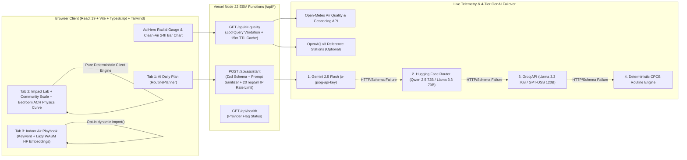

# VayuShield AI

**Deterministic Urban Air Quality Telemetry, Indoor ACH Physics Simulation & 4-Tier Resilient GenAI Planning**

[](https://vayushield-ai-rose.vercel.app/)
[](tsconfig.json)
[](package.json)
[](src/test/App.a11y.test.tsx)
[](.github/workflows/ci.yml)

**Live Demo:** [https://vayushield-ai-rose.vercel.app/](https://vayushield-ai-rose.vercel.app/) · **Architecture Reference:** [docs/ARCHITECTURE.md](docs/ARCHITECTURE.md)

VayuShield AI turns raw urban air pollution telemetry into verifiable, household-level action. Instead of letting an LLM hallucinate air quality indices or generic advice, every pollutant sub-index, 24-hour clean-air window, indoor particulate decay curve, CO₂ commute delta, and community multiplier is computed deterministically in strict TypeScript—and the GenAI layer only synthesizes schedules grounded in those verified numbers.

---

## Why VayuShield AI vs. Generic LLM AQI Wrappers

| Dimension | Generic LLM AQI Chatbot Wrapper | VayuShield AI ("Model Proposes, Code Disposes") |
| :--- | :--- | :--- |
| **AQI Calculation** | Often asks an LLM to guess severity or uses US-EPA / unverified endpoints; vulnerable to `CO` unit errors. | **Deterministic India CPCB NAQI Engine** ([`cpcbAqi.ts`](src/engine/cpcbAqi.ts)) across all 6 pollutants (`PM2.5`, `PM10`, `NO₂`, `SO₂`, `O₃`, `CO`) with contiguous breakpoints clamped to `[0, 500]`. |
| **Daily Timing Guidance** | Static advice ("go out in the morning") that misses thermal inversions or stale past hours. | **24h Clean-Air Window Finder** ([`openMeteoForecast.ts`](src/engine/openMeteoForecast.ts), [`cleanAirWindow.ts`](src/engine/cleanAirWindow.ts)) slicing strictly upcoming hours in the city's local timezone and ranking 2-hour slots by NAQI. |
| **Indoor Air Physics** | Vague tips like "run an air purifier." | **Bedroom Time-to-Clean ACH Physics Simulator** ([`roomCleanPhysics.ts`](src/engine/roomCleanPhysics.ts), [`RoomCleanCurve.tsx`](src/components/RoomCleanCurve.tsx)) solving exponential decay $C(t) = C_{eq} + (C_0 - C_{eq})e^{-\text{ACH} \cdot t/60}$ across room volumes & CADR setups to exact minutes-to-`30 µg/m³`. |
| **Household & Community Impact** | Unquantified motivational copy. | **Choice-Impact & Community Scale Engine** ([`impactCalculator.ts`](src/engine/impactCalculator.ts)) calculating daily `µg/m³` exposure drops (capped at realistic 92%), annual CO₂ savings, tree equivalents, and `1–200` household scaling + 1-click Family Alert ([`communityAlert.ts`](src/engine/communityAlert.ts)). |
| **Reliability & AI Resilience** | Single API key; breaks on rate limits or exposes keys via `VITE_*` client bundles. | **Zero-Key-Leak 4-Tier Server Failover** ([`providers.ts`](api/_lib/providers.ts)): `Gemini 2.5 Flash` → `Hugging Face Router` → `Groq` → `Deterministic Fallback`, plus optional lazy **Browser WASM Semantic Search** (`@huggingface/transformers`). |

---

## System Architecture



---

## Elephant–Goldfish Engineering Rigor (5 Real Bugs Caught & Fixed)

Every scientific calculation and serverless boundary was audited against stateless cold-eyes specification checks and enforced with regression tests:

1. **CO `µg/m³ → mg/m³` 1000× Unit Trap (`src/engine/cpcbAqi.ts`)**
   - *Bug prevented:* Open-Meteo returns `carbon_monoxide` in `µg/m³` (typically `300–2500 µg/m³`), while India CPCB breakpoints expect `mg/m³` (`0–1.0`, `1.0–2.0`, …). Passing raw values directly permanently pinned AQI at `500 (Severe)`.
   - *Fix & Guard:* `calculateCpcbAqi` explicitly takes `coUgM3` and divides by `1000` before sub-index lookup, verified by unit test in [`src/test/cpcbAqi.test.ts`](src/test/cpcbAqi.test.ts).
2. **CPCB Breakpoint Decimal Gaps (`src/engine/cpcbAqi.ts`)**
   - *Bug prevented:* Official summary tables print integer bands (`0–30`, `31–60`), creating dead zones for fractional sensor readings like `30.4 µg/m³`.
   - *Fix & Guard:* Breakpoints are modeled as contiguous upper-bound intervals (`0–30`, `30–60`, `60–90`, `90–120`, `120–250`, `250–500`) with outputs strictly clamped to `[0, 500]`.
3. **Past-Hour Leakage in 24h Clean-Air Windows (`src/engine/openMeteoForecast.ts`)**
   - *Bug prevented:* Open-Meteo's `hourly` array begins at `00:00` local midnight, so slicing `[0..24]` at 8 PM would recommend morning hours that already passed.
   - *Fix & Guard:* Requests `forecast_days=2&timezone=auto&timeformat=unixtime`, locates the first timestamp strictly greater than `now`, slices the next 24 upcoming hours, and formats labels in the selected city's timezone (tested in [`src/test/cleanAirWindow.test.ts`](src/test/cleanAirWindow.test.ts)).
4. **Ozone-vs-PM2.5 NAQI Ranking Alignment (`src/engine/cleanAirWindow.ts`)**
   - *Bug prevented:* On sunny ozone-dominated days (`O₃` NAQI > `PM2.5` NAQI), ranking windows solely by PM2.5 recommended high-ozone windows as "cleanest," and computing PM2.5 savings blindly could produce negative savings percentages.
   - *Fix & Guard:* `analyzeCleanAirWindows` ranks 2-hour windows by average **overall NAQI** first (breaking ties by `avgPm25`) and clamps `exposureSavingsPct` to `0` when the cleanest NAQI slot has equal or higher PM2.5.
5. **Vercel Node 22 ESM Serverless Isolation & Lazy WASM Chunking (`api/_lib/`, `src/services/semanticPlaybook.ts`)**
   - *Bug prevented:* Cross-boundary TypeScript imports without explicit `.js` specifiers fail under Vercel Node ESM (`"type": "module"`), and eager imports of `@huggingface/transformers` bloat initial JS bundles and break CSP/CI.
   - *Fix & Guard:* Server modules in [`api/`](api/) use explicit `.js` relative specifiers and standard `fetch` + `zod` with `Cache-Control` / rate-limiting; `@huggingface/transformers` loads solely via opt-in dynamic `import()` with `useWasmCache = false` aligned to [`vercel.json`](vercel.json) CSP.

---

## PromptWars Challenge 06 — 6-Criteria Verification Matrix

| Judging Criterion | Implementation & Architectural Proof | Verified Source / Test Files |
| :--- | :--- | :--- |
| **1. Code Quality** | Strict TypeScript (`strict: true`, `noUnusedLocals`, `noUncheckedIndexedAccess`), pure deterministic engine functions decoupled from React UI, Zod runtime validation on all API inputs/outputs, and clean ESM boundaries. | [`tsconfig.json`](tsconfig.json), [`src/engine/`](src/engine/), [`api/_lib/schemas.ts`](api/_lib/schemas.ts) |
| **2. Security** | Zero browser-exposed secrets (no `VITE_*` keys), prompt-injection delimiter stripping (`sanitizeUserText`), per-IP rate limiting (`20` req / `5 min` → `429`), strict HTTP security headers (`CSP`, `X-Frame-Options: DENY`, `X-Content-Type-Options: nosniff`, `Permissions-Policy`), and `0` npm vulnerabilities. | [`vercel.json`](vercel.json), [`api/assistant.ts`](api/assistant.ts), [`api/air-quality.ts`](api/air-quality.ts), [`.env.example`](.env.example) |
| **3. Efficiency** | Sub-1 MB tracked repo (`< 10 MB` CI budget), 15-min/hour-aligned telemetry edge caching (`s-maxage`), parallel Open-Meteo + OpenAQ fetches with `AbortSignal.timeout`, manual Vite vendor chunks (`react`, `icons`), and lazy-loaded WASM embeddings. | [`.github/workflows/ci.yml`](.github/workflows/ci.yml), [`vite.config.ts`](vite.config.ts), [`src/services/semanticPlaybook.ts`](src/services/semanticPlaybook.ts) |
| **4. Testing** | Comprehensive automated suite covering CPCB NAQI boundaries & CO conversion, future-only 24h windows & ozone ties, exposure & Community Scale math, ACH indoor physics decay, Family Alert formatting, 4-tier failover, and full UI/axe checks. | [`src/test/cpcbAqi.test.ts`](src/test/cpcbAqi.test.ts), [`src/test/cleanAirWindow.test.ts`](src/test/cleanAirWindow.test.ts), [`src/test/impactCalculator.test.ts`](src/test/impactCalculator.test.ts), [`src/test/roomCleanPhysics.test.ts`](src/test/roomCleanPhysics.test.ts), [`src/test/communityAlert.test.ts`](src/test/communityAlert.test.ts), [`src/test/providerFailover.test.ts`](src/test/providerFailover.test.ts), [`src/test/App.a11y.test.tsx`](src/test/App.a11y.test.tsx) |
| **5. Accessibility** | WCAG 2.1 AA compliance verified via `eslint-plugin-jsx-a11y` and `vitest-axe` (`0` violations): skip link, landmark regions, `aria-live="polite"` updates, full arrow/Home/End keyboard navigation on forecast bars & tabs, `aria-pressed` toggles, `role="img"` SVG labels, and `prefers-reduced-motion` support. | [`eslint.config.js`](eslint.config.js), [`src/styles/index.css`](src/styles/index.css), [`src/components/RoomCleanCurve.tsx`](src/components/RoomCleanCurve.tsx), [`src/test/App.a11y.test.tsx`](src/test/App.a11y.test.tsx) |
| **6. Problem Statement Alignment** | Directly empowers households facing severe urban air pollution with localized India CPCB NAQI telemetry, optimal 2-hour outdoor/ventilation windows, quantified DIY/HEPA bedroom clean-air countdowns, commute CO₂/exposure swaps, community scaling, and resilient AI routines. | [`src/App.tsx`](src/App.tsx), [`src/components/AqiHero.tsx`](src/components/AqiHero.tsx), [`src/components/ChoiceImpactSimulator.tsx`](src/components/ChoiceImpactSimulator.tsx), [`src/components/RoutinePlanner.tsx`](src/components/RoutinePlanner.tsx) |

---

## Quick Start

**Prerequisites:** Node.js `>= 22.12.0` (`22.x` LTS).

```bash
npm ci
npm run dev
```

Open the local URL printed by Vite. In `vite dev` mode without Vercel Functions, the client automatically fetches live Open-Meteo telemetry directly and falls back to the built-in deterministic routine planner. To test the `/api/*` serverless routes locally, run `npx vercel dev`.

---

## Environment Variables

All provider keys are **server-only** and optional—VayuShield AI works out-of-the-box without credentials using Open-Meteo + its deterministic routine engine. See [`.env.example`](.env.example):

| Variable | Purpose | Required? |
| :--- | :--- | :--- |
| `GEMINI_API_KEY` | Tier 1 primary planner (`Gemini 2.5 Flash` with `2.0 Flash` / `2.5 Flash-Lite` fallback) | Optional |
| `HF_TOKEN` | Tier 2 failover via Hugging Face Inference Providers (`router.huggingface.co/v1`) | Optional |
| `HF_MODEL` | Override Tier 2 model ID (default: `Qwen/Qwen2.5-72B-Instruct`) | Optional |
| `GROQ_API_KEY` | Tier 3 failover via Groq (`llama-3.3-70b-versatile`) | Optional |
| `OPENAQ_API_KEY` | Optional nearest ground-station reference overlay via OpenAQ v3 | Optional |

> **Security rule:** Never prefix any secret key with `VITE_`. Keys must remain strictly in Vercel / server environment variables.

---

## Validation & Testing

Run all quality gates before pushing:

```bash
npm run typecheck
npm run lint
npm test
npm run build
npm audit --omit=dev
```

---

## Vercel Deployment

1. Import the repository into Vercel using the **Vite** framework preset.
2. Vercel automatically builds the SPA (`dist/`) and deploys [`api/air-quality.ts`](api/air-quality.ts), [`api/assistant.ts`](api/assistant.ts), and [`api/health.ts`](api/health.ts) with the security headers and 120s function timeout configured in [`vercel.json`](vercel.json).
3. Add any desired optional server keys (`GEMINI_API_KEY`, `HF_TOKEN`, `GROQ_API_KEY`, `OPENAQ_API_KEY`) in **Project Settings → Environment Variables** and redeploy.
4. Verify deployment health via `GET /api/health`.

*Forecasts, exposure reductions, and ACH indoor decay curves are informational estimates and not medical advice.*
